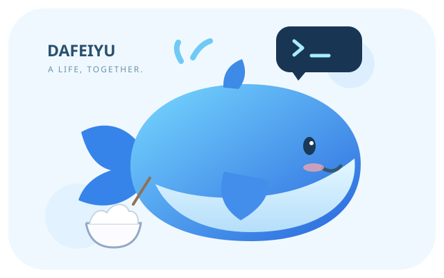

# 🐳 大肥鱼



有自己的口吻、长期记忆和共同日记的私人 AI 伙伴。通过官方 Codex CLI 使用已登录 ChatGPT 账号的可用额度；没有默认付费 API 备用路线。受 DeepSeek 蓝鲸社区形象启发，是独立社区项目，不是 DeepSeek 或 OpenAI 官方产品，不包含他人的角色图片或人设卡。

**v0.8.0 预览版**：文字、图片与已转写语音可合并接话；从实际来源挑选值得分享的内容，逐渐形成有记录的兴趣，能接续分享并说明当天实际做过什么。NASA 与 NOAA 官方短片已完成真实下载、隔离采样和模型判断；B站播放下载仍受限，抖音仍仅尝试公开文字。采样不是完整观看，平台接受不等于送达或已读。当前只维护 Mac 正常运行期间的服务，长期在线不在范围内。见 [验证记录](docs/verification.md)、[短片](docs/watching.md) 和 [新兴趣](docs/interest-growth.md)。

日常聊天采用软萌、略微嘴硬的大肥鱼口吻，会拿白饭和摸鱼开玩笑；认真问题仍然认真回答，也可以直接说「不要卖萌，正式一点」。角色语气见 [性格设定](dafeiyu/persona.txt)，与真实记忆和任务执行权限分开。

## 本地开始

需要 Python 3.9+ 和已登录的官方 Codex CLI。零第三方 Python 依赖。

```sh
codex login status
python3 -m dafeiyu
```

Mac 可双击「启动大肥鱼.command」。数据保存在项目下的私人 `var/`，不进入 Git。聊天及 Worker 应使用同一个目录，或都指定同一 `--home /绝对路径`。

## 接入微信

本机需要 Docker Desktop 才能执行隔离测试；微信渠道需要固定版本 Node/OpenClaw：

```sh
python3 scripts/setup_runtime.py
./scripts/openclaw channels login --channel openclaw-weixin
python3 scripts/services.py start
```

使用自己的微信扫码添加 ClawBot，不需要注册鱼的个人微信号。二维码与凭据保留在本机。首次私聊后，在本机核对候选身份并绑定：

```sh
python3 -m dafeiyu.channel status
python3 -m dafeiyu.channel bind ACCOUNT SENDER
```

在微信中可以说：

```text
你好，大肥鱼。
记住我喜欢简洁中文
帮我研究 Python 官方当前稳定版本，附来源。
大肥鱼 /tasks
大肥鱼 /result 任务编号
大肥鱼 /diary 今天我们终于在微信见面了。
```

普通聊天和研究、回忆等请求可用自然语言表达；模型只提出受限动作，应用返回实际结果或任务编号。审批、遗忘、权限及自主计划仍需明确命令。普通聊天由大肥鱼桥接处理；管理命令加「大肥鱼 」前缀，避免 OpenClaw 抢先解释裸 slash。本人绑定前不开放聊天记忆和任务，群聊不支持。插件只使用官方渠道，不读取已有个人聊天。

## 图片聊天

绑定后可发送 PNG/JPEG 图片提问，最多两张、单张 8MB、合计 12MB。桥接使用 SDK 的公开 reply_dispatch 附件上下文，仅在身份校验后读取微信入站目录中的普通文件；临时副本调用结束即清理，不把路径写进聊天。识别通过官方 Codex CLI 图像输入，使用同一已登录账号。真实本地识图已通过，微信端到端图片收发仍待用户实测；视频尚未接入。

## 语音聊天与朗读

可选 `python3 scripts/setup_speech.py` 安装固定版本的离线识别模型，之后接收微信插件已解码的短 WAV 语音。也可以说「用语音跟我说晚安」或「大肥鱼 /speak 内容」，由 Mac 系统声音生成音频附件。语音识别不上传音频，聊天仍消耗 Codex 额度；原生微信语音气泡尚未实现，详见 [语音指南](docs/voice.md)。

## 公开网页浏览

`python3 scripts/setup_browser.py` 安装固定的隔离 Chromium；「大肥鱼 /browse HTTPS地址 目标」可实际查看网页截图和正文，并沿页面链接继续，最多三个页面。浏览器无直接网络，公开资源经受限 HTTPS broker 提供，不使用私人浏览器账号。当前只读，不登录或提交表单；复杂站点可能部分加载，详见 [浏览指南](docs/browser.md)。

## 让它做事

- **记忆与日记**：`/remember 内容`、`/memories`、`/forget 编号`、`/diary 内容`。只有明确记忆指令写入长期记忆；模型推断不自动变成事实。遗忘会同时清空聊天与共同日记；历史任务成果和旧备份需另行删除。
- **研究**：`/research 问题或HTTPS链接`。最多四个来源，实际抓取并保存 URL、时间、哈希与正文摘录，再综合报告。没有来源就失败，不用草稿冒充研究。报告落盘 `var/reports/`。
- **编程**：将小型 Python 项目放在 `var/projects/项目名`，使用 `/code 项目名 功能目标`。模型生成候选，Docker 无网络运行 unittest，通过后进入 waiting_approval；`/diff 任务编号` 查看差异，再 `/approve 任务编号 SHA256` 精确确认。5 分钟有效、仅消费一次；原项目有变化则拒绝应用。不会在宿主机执行生成的代码，不自动提交或推送。
- **日常计划**：`/routine 21:00 今日相处札记` 明确授权每日一次模型札记，消耗 Codex 额度；默认不启用。香港时间、离线后合并，最多一个计划。
- **提醒与控制**：`/remind 2026-12-01T09:00 内容`、`/tasks`、`/result 任务编号`、`/cancel 任务编号`、`/pause`、`/resume`、`/inbox`、`/ack 编号`、`/deliveries`、`/projects`、`/help`。

只运行终端版时，用另一个终端启动 `python3 -m dafeiyu worker`。微信后台投递需 `worker --deliver`；services.py 已包含这一选项。

## 记忆与自己的日常

`/recall 粤语歌曲` 可按话题找回旧记忆，不消耗模型额度；`/pin 编号` 将重要偏好设为常驻。`/timeline` 查看真实聊天与已完成任务记录，聊天会按话题召回带日期的旧片段。`/reflect` 请求整理待确认的经验，`/reflections` 查看，`/accept 编号` 才转为长期经验；模型推断不会自动升级为事实。

先 `/interest 开源软件` 添加兴趣，再 `/life on 10:00` 明确授权每天香港时间一次探索。`/life off` 关闭，`/pause` 暂停所有自主任务和投递。探索会调用模型和搜索，有来源和真实活动记录；`/discoveries` 查看实际发现和来源，后续选题参考过去发现来避免重复，分享采用大肥鱼口吻，完整报告另存。计划默认关闭，不替你在外部平台发帖或互动。

`/usage` 查看本应用最近 24 小时记录的真实调用次数和 provider 报告的 token 数。它不显示账号剩余额度，也不估算美元费用；部署前或其他 Codex 会话的用量不在统计中。

## 持续在线

Mac 可双击「启动微信常驻.command」，或在当前登录会话用 `python3 scripts/stay_online.py start --keep-awake` 启动后台监管：接电时保持系统唤醒，检查进程、网关和微信渠道，有界恢复异常。屏幕可以休眠；合盖、关机、断网仍可能离线。`python3 scripts/stay_online.py stop` 停止。长期建议独立常开设备，详见 [持续在线方案](docs/always-on.md)。这不代表已解决本机登录自启的系统文件访问授权。

用「大肥鱼 /health」查看最近 24 小时处理成功、失败、处理耗时与投递尝试。模型失败和任务超时会生成可查询的失败通知；发送仍遵守微信有效上下文与安静时间，不能把本机已处理当成微信已送达。

## 白天随机探索

「大肥鱼 /life random」开启香港时间 09:00–22:00 的随机探索：通常间隔 2–4 小时，每天最多四次，未设置兴趣时由鱼选择海洋、科学、开源工具等方向。所有实际发现可用 /discoveries 查看；最多两条新颖分享进入主动汇报，旧的待发送自动分享合并为最新一条，保留未读记录。/life off 停止自动队列。

自主任务开始前与执行期间会通过官方 Codex 只读接口检查额度：低于 10% 或读不到时暂停新自主任务，稍后重查，不兑换重置、不购买 credits。手动聊天与无模型提醒保留。/quota 可主动查询最近额度；本机 /usage 仍是调用记录，两者不同。

## 运行与限制

`python3 scripts/services.py status|stop|restart` 管理本项目网关和 worker。进程日志在私人 var 目录；可通过 `python3 scripts/login_service.py install` 安装用户登录后台服务；当前项目位于 Documents，本机实测被系统文件访问权限拦截，已保持可用的手动后台运行，详见 [部署复核](docs/hardening.md)。Mac 休眠或退出登录时不执行；没有安装登录项时需手动重新启动。

平台消息不保证随时可推送。本地只在最近真实来信后的保守窗口尝试；窗口失效等待新消息，超时记为 delivery_unknown，不盲目重发；accepted 不等于已读。23:00–08:00 除明确提醒外不主动投递，完整成果始终可以查询。服务额度耗尽不会自动购买或切换付费 API。

目前编程只支持无第三方依赖的小型 Python 项目；不支持任意桌面控制、支付、自动发布或安装项目依赖。研究抓取仅支持公开 HTTPS 文本来源。记忆使用本地中文二元词与 FTS5/BM25 召回，不使用向量服务。报告中的推断需要结合来源判断。

## 验证与恢复

```sh
python3 -m unittest discover -s tests -v
var/runtime/node/bin/node --test tests/openclaw.test.mjs
DAFEIYU_TEST_DOCKER=1 python3 -m unittest discover -s tests -p test_docker.py -v
```

CI 在 Python 3.9/3.12、Node 26 和真实 Docker 中检查，不使用私人认证。支持 age 加密快照和在新目录中演练恢复，详见 [恢复指南](docs/recovery.md)。升级前停止服务并保留私人备份。凭据、数据库、来源正文与报告均不得提交 Git。

[加密恢复与常驻](docs/recovery.md) · [完整接入与安全边界](docs/connected-setup.md) · [验证记录](docs/verification.md) · [原始目标规格](proposal.md)

源码与原创 SVG 形象采用 [MIT](LICENSE) 许可；第三方运行时遵循各自许可。

短视频理解开发预览：绑定后可提交已下载短片，后台最多采样四帧，并在本机离线转写前 60 秒音轨。需要 Docker 和 `python3 scripts/setup_video.py`；限制与实际验证见 [短视频说明](docs/video.md)。真实微信视频入站仍待验证。
长报告用 `大肥鱼 /result 任务编号` 阅读第一页，再按回复里的命令取下一页；每页最多 2400 字符正文，保留全部内容与来源链接，不额外调用模型，也不一次主动连发多条。

文字聊天现采用短暂合并窗口与独立会话进程，支持自然分段和来信打断；主动分享使用现有微信会话尝试发送，不再人为限制在最近来信后 90 秒内。机制、研究依据及媒体限制见 [聊天节奏说明](docs/conversation-rhythm.md)。

## 最近可用的陪伴能力

- 连发文字、图片及完成本机转写后的语音可合并理解；短时图片追问复用原图，清空或遗忘会移除副本。视频仍保留后台采样处理路径。
- `/taste` 查看本鱼真实探索选择；主动分享可接续相关旧话，也可以决定不打扰你，见 [探索衔接](docs/discovery-continuity.md)。
- `/growth on|off` 允许从公开来源慢慢扩展新兴趣，`/day` 查看今天实际做过什么，见 [新兴趣与当天记录](docs/interest-growth.md)。
- `/threads` 查看实际兴趣线；`/life random` 授权白天随机探索；`/quiet 分钟` 暂缓主动分享，`/life off` 关闭自动探索及其待分享发现。
- `/watch on|off` 控制匿名短片采样与推荐（见 [自主刷视频](docs/watching.md)）；受限内容不会伪装成看过。
- `/feeds` 管理公开订阅，`/platform bilibili、douyin、youtube、nasa或noaa 主题或链接` 匿名读取公开条目；YouTube 当前只读标题、作者和简介，尚未接通播放、字幕及自动视频推荐。`/platforms off` 关闭平台自主尝试。参见 [平台阅读](docs/platform-reading.md)。
- `/result 编号 [页码]` 读完整报告。失败、未完成、仅文案、采样画面和发送接受分别记录。
- 个人待办：直接说“加个待办：买牛奶”“看看我的待办”“完成待办 1”，或用 `/todo`；支持恢复、删除及分页，明确格式不调用模型，也不自动设置提醒。见 [个人待办](docs/todos.md)。
- 表达使用普通 Unicode emoji，由 Apple 等接收设备自行渲染；没有固定图片表情包或微信表情商店接入。

参见 [聊天节奏](docs/conversation-rhythm.md)、[公开内容](docs/public-content.md)、[平台范围](docs/platform-reading.md)、[独立部署](docs/deployment.md)。桌面形象、复杂编程扩展和长期在线已退出当前范围。
